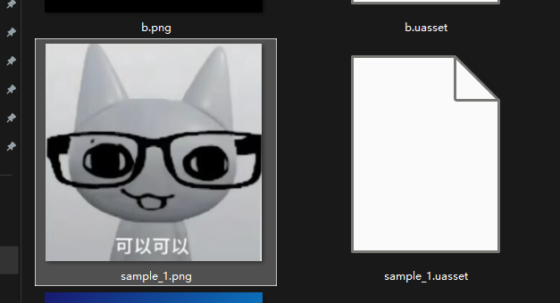
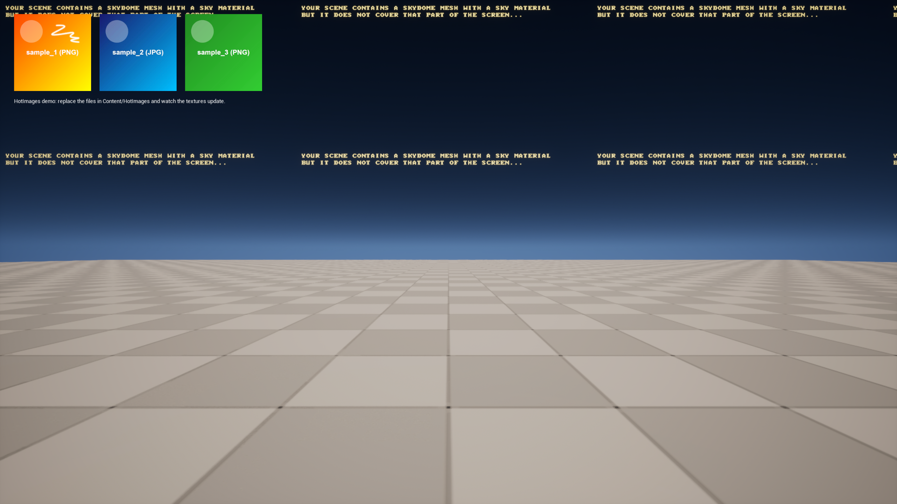

# HotImages 插件详细使用手册

> 适用范围：Unreal Engine 5.x，当前项目已在 UE 5.4 与 UE 5.7 编译验证。运行时自动目录监听目前仅支持 Windows。

## 1. 插件用途

HotImages 用来保持项目外部图片文件和 Unreal Engine `UTexture2D` 资产同步。它适合以下场景：

- 展板、公告、活动图和运营素材需要在不重新打包游戏的情况下替换；
- UMG、材质或蓝图需要一直引用同一个纹理对象，但纹理像素和尺寸可以动态改变；
- 美术人员直接修改指定目录中的 PNG/JPEG，编辑器自动生成或更新对应纹理；
- 在 UE 中导入、重新导入或调整纹理尺寸设置后，需要反向生成运行时可替换的 PNG。

插件包含两条同步路径：

```text
外部图片 → 编辑器自动 Import/Reimport → UTexture2D 代理资产
外部图片 → 打包程序解码 → 原地刷新已加载的 UTexture2D

UE 导入/修改纹理 → 编辑器反向导出 PNG → 外部图片目录
```

运行时更新不会替换 `UTexture2D*` 对象本身，只会重建它的像素、尺寸和渲染资源，因此材质、UMG 和蓝图中已有的纹理引用不会断开。

## 2. 文件与模块结构

```text
HotImages/
├─ HotImages.uplugin
├─ Config/
│  └─ DefaultGame.ini
└─ Source/
   ├─ HotImagesRuntime/       设置、路径映射、目录监听、图片解码、运行时刷新
   └─ HotImagesEditor/        自动导入、重新导入、反向导出、打包目录登记

HotImageDemo/
├─ Content/HotImages/         示例图片和代理纹理
├─ Config/DefaultGame.ini     Demo 设置
└─ Source/HotImageDemo/       HUD 运行示例
```

## 3. 安装插件

### 3.1 安装到自己的项目

1. 关闭 Unreal Editor。
2. 将仓库中的整个 `HotImages` 目录复制到目标工程：

   ```text
   <你的工程>/Plugins/HotImages/
   ```

3. 确认下面的文件存在：

   ```text
   <你的工程>/Plugins/HotImages/HotImages.uplugin
   ```

4. 打开 `.uproject`。
5. 如果 UE 提示需要重新编译模块，选择编译。
6. 在 `Edit > Plugins` 中搜索 `HotImages`，确认插件处于启用状态。
7. 重启编辑器。

### 3.2 运行仓库内的 Demo

在仓库根目录执行一次：

```powershell
.\SetupDemoPlugin.ps1
```

该脚本会创建：

```text
HotImageDemo/Plugins/HotImages
```

它是指向仓库插件目录的 junction。之后打开：

```text
HotImageDemo/HotImageDemo.uproject
```

Demo 当前使用 UE 5.4。

## 4. 项目设置

插件设置位于：

```text
Edit > Project Settings > Plugins > Hot Images
```

### 4.1 Watch Folders

`WatchFolders` 是相对于项目 `Content` 目录的路径列表。

默认值：

```text
HotImages
```

对应实际目录与 UE 资产目录：

```text
磁盘：<Project>/Content/HotImages
资产：/Game/HotImages
```

可以添加多个目录，例如：

```text
HotImages
TEST
UI/RemoteImages
```

注意事项：

- 填写相对路径，不要填写磁盘绝对路径；
- 路径中的反斜杠会被规范化为 `/`；
- 当前只扫描目录第一层，不递归扫描子目录；
- 同一个槽位名出现在多个目录中时，优先使用配置列表中靠前且存在图片的目录；
- 插件自动去除前后的 `/` 和可选的 `Content/` 前缀。

### 4.2 Auto Sync In Editor

`bAutoSyncInEditor = true` 时：

- 编辑器启动后自动扫描所有 WatchFolder；
- 新图片会创建同名 `UTexture2D`；
- 已有图片发生变化时，会静默 Reimport 对应纹理；
- 设置列表变化时，会重启监听并重新扫描。

关闭后不会自动扫描，但可以从编辑器菜单手动触发：

```text
Tools > Hot Images > Rescan Hot Images Folders
```

### 4.3 Update Debounce Seconds

默认值为 `0.5` 秒。

它用于合并保存图片时产生的一连串文件事件，避免文件尚未写完就开始解码。普通项目建议保持 `0.3–1.0` 秒。

### 4.4 Apply Changes At Runtime

`bApplyChangesAtRuntime = true` 时，Windows 打包程序会监听松散图片目录，并刷新已经加载的代理纹理。

编辑器进程默认走资产 Reimport 路径，不会同时运行内存替换路径。需要模拟打包逻辑时，可使用：

```powershell
UnrealEditor.exe <Project>.uproject -game -HotImagesRuntimeSimulation
```

## 5. 图片、槽位和资产的对应关系

图片文件的基础文件名就是 `SlotName`。

| 图片文件 | SlotName | UE 代理纹理 |
|---|---|---|
| `Content/HotImages/banner.png` | `banner` | `/Game/HotImages/banner` |
| `Content/HotImages/avatar.jpg` | `avatar` | `/Game/HotImages/avatar` |
| `Content/TEST/help.jpeg` | `help` | `/Game/TEST/help` |

一个典型目录如下：

```text
Content/HotImages/
├─ sample_1.png       外部图片
├─ sample_1.uasset    代理纹理
├─ sample_2.jpg
├─ sample_2.uasset
├─ sample_3.png
└─ sample_3.uasset
```

打包后，同一目录会作为 NonUFS 松散文件出现，可以直接替换其中的图片：



> `.uasset` 出现在截图中的原因是 UE 的 NonUFS 目录复制会复制整个目录。运行时真正读取的是 PNG/JPG/JPEG；代理纹理本身仍从 Cooked 资产中加载。

## 6. 支持的图片格式

支持：

- PNG；
- JPEG，扩展名可以是 `.jpg` 或 `.jpeg`；
- 文件名扩展名写成 `.png`、但文件实际编码为 JPEG 的图片也可以在运行时通过文件签名识别。

当同一个目录同时存在以下文件时：

```text
banner.png
banner.jpg
```

插件固定优先选择 `banner.png`。

建议仍然保持扩展名和实际格式一致。这样便于编辑器导入、人工检查和其他图片工具正确处理。

以下文件会被忽略：

- 点开头文件；
- 非 PNG/JPG/JPEG 文件；
- 子目录中的图片；
- `.tmp` 等临时文件，因为扩展名不受支持。

## 7. 编辑器工作流：外部图片生成纹理

### 7.1 新增图片

1. 在 `Content/HotImages` 中放入图片，例如：

   ```text
   promotion.png
   ```

2. 等待去抖时间。
3. 插件在同一 UE 资产目录创建：

   ```text
   /Game/HotImages/promotion
   ```

4. 将该纹理拖入材质、UMG、Niagara 或蓝图使用。

如果没有自动出现：

1. 确认 `Auto Sync In Editor` 已开启；
2. 确认目录位于某个 WatchFolder 第一层；
3. 执行 `Tools > Hot Images > Rescan Hot Images Folders`；
4. 查看 Output Log 中的 `LogHotImages`。

### 7.2 更新已有图片

直接覆盖原文件，并保持基础文件名不变：

```text
旧：promotion.png
新：promotion.png
```

插件会 Reimport 同一个代理纹理，而不是创建新资产，因此已有引用继续有效。

### 7.3 修改图片尺寸

替换图片时允许修改宽高，例如：

```text
旧图：512 × 512
新图：1024 × 256
```

编辑器会根据新源文件重新导入。打包运行时会重新创建纹理 PlatformData 和渲染资源，并关闭旧的 Texture Streaming/Virtual Texture Streaming，避免旧尺寸的 Cooked Mip 再次覆盖更新结果。

应用层需要注意：

- UMG Image 如果设置了固定宽高，显示区域不会自动变大，但纹理采样会更新；
- 材质 UV 仍使用 `0–1`，通常不需要修改；
- 频繁加载超大图片会增加解码时间和显存占用；
- 运行时只生成一个 BGRA8 Mip，不适合作为需要完整 Mip 链的大型场景纹理。

## 8. 编辑器工作流：UE 纹理反向导出 PNG

只有直接位于 WatchFolder 下的纹理会参与反向导出。例如：

```text
/Game/HotImages/foo       会导出
/Game/HotImages/Sub/foo   不会导出
/Game/Other/foo           不会导出
```

以下操作会安排一次反向导出：

- 在 Content Browser 中向 WatchFolder 正常导入纹理；
- 对该纹理执行 Reimport；
- 修改 Power Of Two、Padding 或指定分辨率等相关属性。

输出路径：

```text
纹理：/Game/HotImages/foo
图片：Content/HotImages/foo.png
```

插件使用以下方式避免同步循环：

1. 图片先写入 `.tmp`；
2. 写完后原子替换目标 PNG；
3. 记录导出内容哈希和文件时间戳；
4. 目录监听发现这个文件事件时，跳过插件刚刚导出的版本。

## 9. 蓝图使用

运行时入口是 GameInstance Subsystem：

```text
Hot Image Subsystem
```

### 9.1 获取纹理

蓝图逻辑：

```text
Get Game Instance Subsystem (Hot Image Subsystem)
    → Get Texture
        Slot Name = "sample_1"
    → Set Brush From Texture / 设置材质纹理参数
```

`GetTexture` 的行为：

1. 按 WatchFolder 顺序寻找同名图片；
2. 加载对应代理纹理；
3. 运行时刷新开启时，检查磁盘图片是否需要应用；
4. 返回 `UTexture2D*`。

### 9.2 主动刷新

- `RefreshSlot(SlotName)`：强制刷新一个槽位；
- `RefreshAll()`：强制扫描并刷新所有已加载槽位；
- `IsRuntimeWatching()`：判断运行时目录监听是否成功启动。

### 9.3 监听刷新事件

绑定：

```text
On Hot Image Updated
```

事件参数：

- `SlotName`：发生变化的槽位；
- `Texture`：完成更新的纹理对象。

如果 UI 只在图片变化时需要调整布局，可以在该事件中读取新纹理尺寸并更新控件，而不需要每帧调用刷新函数。

## 10. C++ 使用

模块依赖中加入：

```csharp
PublicDependencyModuleNames.AddRange(new string[]
{
    "Core",
    "CoreUObject",
    "Engine",
    "HotImagesRuntime"
});
```

C++ 示例：

```cpp
#include "HotImagesSubsystem.h"
#include "Engine/GameInstance.h"
#include "Engine/Texture2D.h"

UHotImageSubsystem* HotImages =
    GetGameInstance()->GetSubsystem<UHotImageSubsystem>();

if (HotImages)
{
    UTexture2D* Texture = HotImages->GetTexture(TEXT("sample_1"));
    if (Texture)
    {
        const int32 Width = Texture->GetSizeX();
        const int32 Height = Texture->GetSizeY();
        // 将 Texture 交给材质、UMG 或其他系统。
    }
}
```

事件绑定示意：

```cpp
HotImages->OnHotImageUpdated.AddDynamic(
    this,
    &UMyWidget::HandleHotImageUpdated);
```

接收函数需要声明为 `UFUNCTION()`，签名为：

```cpp
UFUNCTION()
void HandleHotImageUpdated(const FString& SlotName, UTexture2D* Texture);
```

## 11. 打包设置

运行时需要同时具备两类文件：

1. Cooked 代理纹理，用来提供可加载的 `UTexture2D` 对象；
2. NonUFS 松散图片，用来在部署后直接替换。

### 11.1 Additional Non-Asset Directories To Copy

每个 WatchFolder 都应该出现在：

```text
Project Settings
  > Packaging
  > Additional Non-Asset Directories To Copy
```

配置文件形式：

```ini
[/Script/UnrealEd.ProjectPackagingSettings]
+DirectoriesToAlwaysStageAsNonUFS=(Path="HotImages")
```

在项目设置中新增 WatchFolder 时，编辑器模块会自动添加这一项并尝试写入 `DefaultGame.ini`。

删除 WatchFolder 时，插件不会自动删除已有的 Packaging 项，避免误删项目手动配置。

### 11.2 Additional Asset Directories To Cook

如果代理纹理已被关卡、材质、UMG 或其他资产硬引用，它会正常进入 Cook。

如果希望仅通过 `GetTexture("name")` 动态加载、且项目中没有其他引用，应添加：

```text
Project Settings
  > Packaging
  > Additional Asset Directories To Cook
  > /Game/HotImages
```

配置形式：

```ini
+DirectoriesToAlwaysCook=(Path="/Game/HotImages")
```

否则未被引用的代理纹理可能不会进入最终包体，运行时会因为找不到 `UTexture2D` 而无法刷新。

## 12. 打包与部署步骤

1. 确认所有需要动态加载的图片均已有同名代理纹理；
2. 确认 WatchFolder 已加入 NonUFS 复制目录；
3. 确认没有硬引用的代理资产目录已加入 Always Cook；
4. 执行 Windows Package Project；
5. 打包完成后检查：

   ```text
   <PackageRoot>/<ProjectName>/Content/HotImages/
   ```

6. 启动打包程序；
7. 用新图片覆盖同名文件；
8. 等待去抖时间，观察画面更新。

Demo 运行画面如下，三个纹理通过 `GetTexture` 取得并绘制：



> 截图顶部的 Skydome 警告来自 Demo 场景本身，与 HotImages 插件无关。

## 13. 打包后正确替换图片

例如需要替换：

```text
sample_1
```

应覆盖：

```text
<PackageRoot>/<ProjectName>/Content/HotImages/sample_1.png
```

不要修改以下位置来期待已打包程序自动读取：

```text
项目源码目录中的 Content/HotImages
Saved/StagedBuilds 中另一个旧包
Cooked 目录
Pak/IoStore 内部资产
另一个同名打包目录
```

最可靠的确认方式是查看运行日志中的监听路径：

```text
LogHotImages: HotImageSubsystem: watching '<实际路径>' for image updates.
```

图片发生变化并成功应用时会看到：

```text
LogHotImages: HotImageSubsystem: refreshed slot 'sample_1' from '<图片路径>'.
```

## 14. 失败重试策略

插件会保护上一版有效内容。如果新文件仍在写入、损坏或无法解码：

- 不会清空纹理；
- 不会替换为黑图；
- 保留上一版像素；
- 同一失败文件版本不会因为游戏每帧调用 `GetTexture` 而反复解码；
- 文件系统再次报告变化，或调用强制刷新后，才会再尝试一次。

典型日志：

```text
DecodeImageFile: '<path>' is not a valid PNG/JPEG image.
ApplySlotFromDisk('sample_1'): keeping previous texture content.
```

## 15. 常见问题排查

### 15.1 替换后仍显示旧图片

按顺序检查：

1. 是否覆盖了日志中实际监听的打包目录；
2. 基础文件名是否和代理纹理一致；
3. 同名 `.png` 是否覆盖了你新增的 `.jpg`；
4. 代理纹理是否已经 Cook；
5. 该纹理是否已经被加载；
6. `bApplyChangesAtRuntime` 是否开启；
7. 日志是否出现解码失败；
8. 文件是否仍被其他程序占用或尚未写完。

### 15.2 新图片没有生成代理纹理

- 只在编辑器模式自动生成；
- 确认 `bAutoSyncInEditor`；
- 确认文件直接位于 WatchFolder 第一层；
- 使用 Tools 菜单执行手动扫描；
- 检查同名 `.uasset` 是否存在但不是 `UTexture2D`。

### 15.3 `GetTexture` 返回空

- SlotName 只填写基础文件名，不包含扩展名；
- 动态加载的资产目录应加入 Always Cook；
- 确认 `/Game/<WatchFolder>/<SlotName>` 是 `UTexture2D`；
- 检查多个 WatchFolder 中是否存在重名槽位；
- 检查资产名称大小写。

### 15.4 JPG 没有生效

如果同时存在：

```text
foo.png
foo.jpg
```

插件使用 `foo.png`。删除或改名旧 PNG 后，才会选择 JPG。若文件叫 `.png` 但内容实际是 JPEG，新版运行时可以通过文件头识别，但仍建议正确导出格式。

### 15.5 新尺寸显示不正确

- 首先读取 `Texture->GetSizeX/GetSizeY` 确认纹理资源已更新；
- 检查 UMG 控件是否固定宽高；
- 检查材质是否使用自定义 UV 缩放；
- 确认运行的是重新打包后的新版可执行文件；
- 检查是否误启动了旧的 Package 目录。

### 15.6 非 Windows 没有自动刷新

目录监听目前只实现了 Windows `ReadDirectoryChangesW`。其他平台可以调用：

```text
RefreshSlot
RefreshAll
```

但还需要自行安排触发时机和确保外部图片可访问。

## 16. 日志与诊断

日志分类：

```text
LogHotImages
```

打包程序日志通常位于：

```text
<PackageRoot>/<ProjectName>/Saved/Logs/<ProjectName>.log
```

建议关注：

| 日志内容 | 含义 |
|---|---|
| `watching` | 目录监听成功启动 |
| `refreshed slot` | 图片已成功应用 |
| `no png/jpg file found` | 槽位找不到对应图片 |
| `cannot read file` | 文件不存在、被占用或无读取权限 |
| `not a valid PNG/JPEG image` | 图片损坏或格式无法识别 |
| `keeping previous texture content` | 新图失败，旧图被安全保留 |
| `runtime refresh is disabled` | 当前进程没有启用运行时刷新 |

## 17. API 速查

### `UHotImageSubsystem`

| 成员 | 用途 |
|---|---|
| `GetTexture(SlotName)` | 加载并返回代理纹理，必要时应用磁盘图片 |
| `RefreshSlot(SlotName)` | 强制刷新指定槽位 |
| `RefreshAll()` | 强制刷新所有已加载槽位 |
| `IsRuntimeWatching()` | 判断目录监听是否已经启动 |
| `OnHotImageUpdated` | 成功刷新后的动态多播事件 |

### `UHotImageSettings`

| 设置 | 默认值 | 用途 |
|---|---:|---|
| `WatchFolders` | `HotImages` | Content 相对监听目录列表 |
| `bAutoSyncInEditor` | `true` | 编辑器自动导入/重导 |
| `UpdateDebounceSeconds` | `0.5` | 文件事件去抖时间 |
| `bApplyChangesAtRuntime` | `true` | 打包运行时刷新开关 |

## 18. 当前限制

- 自动目录监听仅支持 Windows；
- 目录扫描不递归；
- 只支持 PNG/JPG/JPEG；
- 运行时只刷新已有代理纹理，不能凭空创建 Cooked `UTexture2D` 资产；
- `RefreshAll` 只更新当前已经加载的纹理；
- Runtime 热纹理只有一个 BGRA8 Mip；
- NonUFS 会复制 WatchFolder 中的整个目录，可能包含 `.uasset`；
- 删除外部图片不会删除代理资产，以免破坏引用；
- 同名图片跨多个 WatchFolder 时按配置顺序决定优先级。

## 19. 上线前检查清单

- [ ] 插件已启用并成功编译；
- [ ] WatchFolders 配置正确；
- [ ] 编辑器能为每张图片生成同名代理纹理；
- [ ] 材质或 UI 引用的是代理纹理；
- [ ] WatchFolder 已登记为 NonUFS；
- [ ] 动态加载目录已加入 Always Cook；
- [ ] `bApplyChangesAtRuntime` 已开启；
- [ ] 打包后目标图片确实位于运行程序的 `Content/<WatchFolder>`；
- [ ] 替换 PNG/JPEG 后日志出现 `refreshed slot`；
- [ ] 测试过图片宽高发生变化；
- [ ] 测试过损坏图片不会覆盖上一版内容；
- [ ] 最终交付的是包含最新插件代码的重新打包版本。

